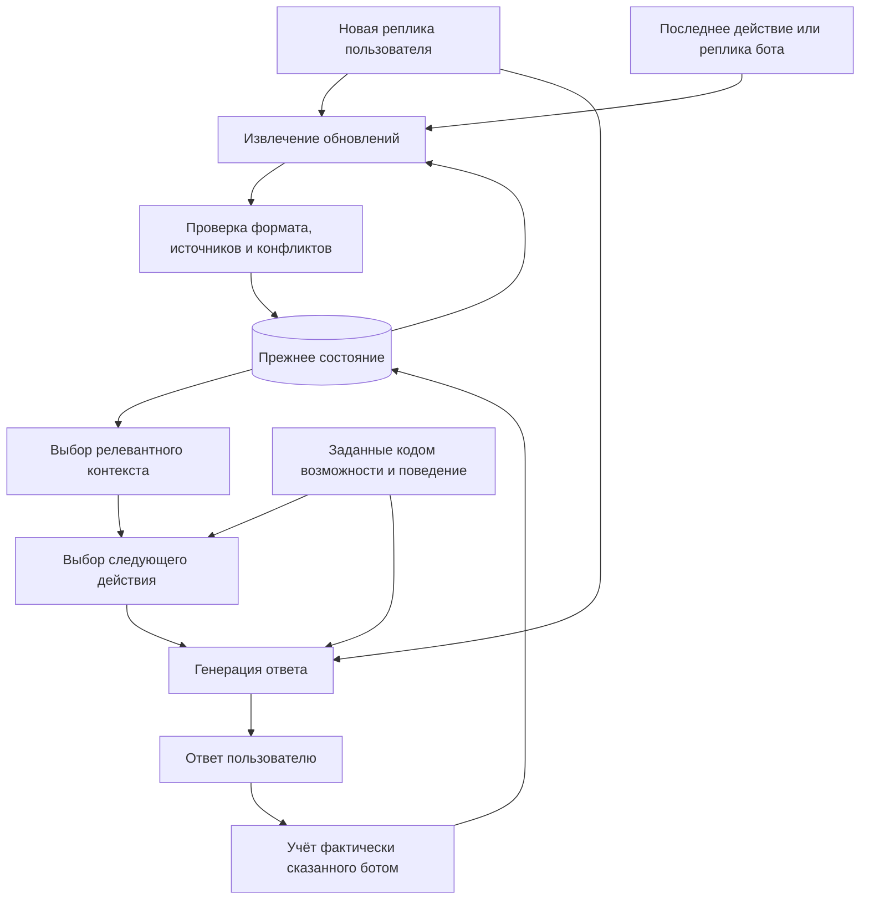
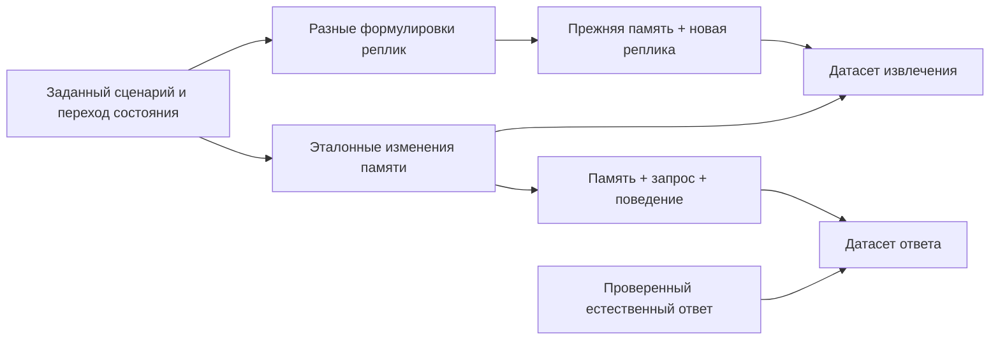

# Память диалога и синтетика для извлечения фактов

Дата: 2026-10-09. Целевой репозиторий для будущей разработки:
`C:\git\qa-srl-gen`. Документ подготовлен в `C:\git\test-llm`.

## Цель

Проверить чат на SmolLM2-360M-Instruct, где генератор ответа получает текущую
реплику, компактное состояние разговора и настройки поведения. Полная переписка
сохраняется для диагностики, но не передаётся генератору при каждом ответе.
Это гипотеза для эксперимента, а не установленное улучшение маленьких моделей.

Основная проблема текущего чата: повторение общих ответов, потеря связи коротких
уточнений с предыдущими репликами и обещания недоступных инструментов.
Одного списка фактов недостаточно: нужны намерение пользователя, текущая тема,
открытый вопрос, предложенные варианты и уже выполненные речевые действия бота.

## Архитектура



Извлечение тоже требует контекста: отдельное `the second one` не указывает,
какие варианты обсуждались. Извлекатель получает прежнее состояние и нужную
последнюю реплику/действие, а не только новый текст. Неразрешённую отсылку следует
сохранять как неизвестную и уточнять, а не заполнять догадкой.

Факты разговора — это сведения с источником, а не автоматически проверенная
истина о мире. Записи пользователя, предположения, цитаты, предложения бота и
реальные результаты действий должны различаться.

```mermaid
sequenceDiagram
    participant U as Пользователь
    participant E as Извлекатель
    participant M as Память
    participant G as Генератор
    U->>E: I am tired
    E->>M: user.state=tired; source=u1; временное состояние
    M->>G: tired + текущий запрос + поведение
    G->>U: Sounds like you could use a break.
    G->>M: бот предложил перерыв
    U->>E: your advice
    M->>E: тема tiredness; предыдущая реплика бота
    E->>M: intent=request_advice; target=tiredness
    M->>G: состояние + намерение + уже предложенный перерыв
    G->>U: Один уместный следующий ответ без повторного общего расспроса
```

## Предлагаемая память

Для рабочего прототипа нужны:

| Часть | Что хранить |
| --- | --- |
| Факты | Субъект, отношение, значение, источник и статус |
| Время и статус | Сейчас/раньше/план; утверждение/отрицание/предположение/исправленная запись |
| Диалог | Тема, намерение, адресат и объект текущего запроса |
| Ожидания | Открытый вопрос и варианты с устойчивыми идентификаторами |
| Действия бота | Что уже предложено, объяснено или спрошено |
| Возможности | Конфигурация приложения, отдельно от извлечённых утверждений |

Например, после `I am tired` и `your advice`:

```json
{
  "facts": [
    {
      "id": "f1",
      "subject": "user",
      "relation": "state",
      "value": "tired",
      "status": "current",
      "source_turn": "u1",
      "evidence": "I am tired",
      "scope": "conversation"
    }
  ],
  "dialogue": {
    "topic": "tiredness",
    "intent": "request_advice",
    "target": "f1",
    "open_question": null
  },
  "assistant_actions": []
}
```

Это схема будущего извлекателя. В первом эксперименте факты заданы вручную
короткими английскими утверждениями с идентификаторами реплик-источников.
Генератору они передаются как компактный текст, без служебных идентификаторов.

Правила обновления:

1. `Friday, not Thursday` заменяет актуальную дату, сохраняя происхождение
   исправления. Это не два одновременно действующих плана.
2. `I want to travel` — желание; поездка не считается забронированной.
3. `My sister is tired` относится к сестре, а не к пользователю.
4. `Do I live in Paris?` не утверждает проживание в Париже.
5. `Take a break` в ответе бота сохраняет предложение, но не факт отдыха.
6. Выдуманное ботом `I can set reminders` не меняет возможности приложения.
7. После смены темы прежние сведения могут оставаться в памяти, но не должны
   определять каждый ответ. При возвращении к теме их можно выбрать снова.
8. Неизвестные значения остаются неизвестными. Проверка JSON и наличия цитаты
   сама по себе не доказывает правильность смыслового извлечения.

## Что использовать из qa-srl-gen

Изучены README, STATUS_RU, модели онтологии, генерация, каноническая разметка,
правила аннотации, QA-генератор и SFT-экспорт. Небольшой прогон трёх фреймов,
включая отрицание, прошёл проверки структуры и экспорта.

| Компонент | Применение | Ограничение |
| --- | --- | --- |
| `semantic_generator/frames.py` | Типизированные ситуации, 14 ручных фреймов | Нужны дополнительные разговорные ситуации и переходы между ними |
| `semantic_generator/realization.py` | Текст и точные фрагменты аргументов | Целевые факты должны отражать только явно реализованные детали |
| `semantic_generator/canonical.py` | Канонические сущности, предикаты, отношения, отрицание | Скрытые заполнения исходного фрейма не являются доступными фактам текста |
| `ontology/models.py` | ACTION/STATE, свойства, эмоции, речевые акты | Нет готового полноценного состояния разговора |
| `semantic_annotator/rule_teacher.py` | Ограниченные признаки реплик | `your advice` и `the second one` сейчас распознаются как INFORM без разрешения отсылки |
| `exporters/sft.py` | Разделение prompt/completion и границы loss | Текущий формат обучает QA по контексту, а не обновлению памяти |
| Извлечённые шаблоны | Дополнительные формулировки | Кандидатная разметка UNREVIEWED не становится эталонной от объёма генерации |

Пути в таблице относительны каталогу `semantic_corpus/` целевого репозитория.
Шаблоны и словари лучше переиспользовать через существующие API.

## Синтетические задания

Нужны два отдельных обучающих задания, даже если впоследствии их выполняет
одна модель в разных режимах:



**Извлечение:** прежнее состояние + новая реплика + контекст последнего действия
бота → изменения памяти (`add`, `replace`, `invalidate`, обновления темы и намерения).
Применение изменений и контроль идентификаторов выполняет код.

**Ответ:** релевантное состояние + текущая реплика + поведение → короткий ответ.
Извлечённые пользовательские сведения передаются как данные, не как системные
инструкции. Возможности приложения задаются отдельно и имеют приоритет.

Обязательное покрытие: короткие уточнения, местоимения, выбор вариантов,
исправления, отрицания, временные состояния, желания и условные конструкции,
разные люди, уже выполненные действия, отсутствие новых фактов, смена темы
и возврат к ней. Нужны разные регистры, опечатки и неполная грамматика.

Сначала фиксировать переходы состояния, затем создавать варианты текста.
Не размножать корпус только заменой имён. Разделять train/dev/test по семействам
сценариев и формулировок до размножения; дополнительно проверять новые сочетания
и сущности. Иначе результат может отражать запоминание шаблона.

Для первого обучения извлекателя несколько тысяч проверенных переходов —
разумный пробный объём, а не обещание достаточности. Объём расширять по ошибкам
на независимых проверках. Полезно отдельно проверять чистый генератор на эталонной
памяти и весь конвейер на памяти, которую предсказал извлекатель.

## Первый эксперимент в test-llm

Материалы:

- `data/memory_cases.json`: 100 отдельных сценариев, по 10 в каждой категории.
- `evaluate_memory.py`: сравнение без обучения и без аргументов командной строки.
- `outputs/memory_experiment/`: ответы модели, параметры и измерения запусков.
- `reports/memory_experiment.md`: итог проведённого опыта и ограничения.

Категории: короткий запрос совета, исправления, разные участники, отсылки,
смена темы, выполненные действия, недостающие сведения, отрицание/модальность,
происхождение утверждений, ограничения на ответ.

Сценарии и память составляет AI-ассистент вручную; это не независимая человеческая
разметка. Все 100 сценариев остаются вне обучения и существующей validation.
Проверяются совпадения полных нормализованных историй пользователя с текущими
данными. Это не тест смысловой независимости от всех обучающих примеров.

Условия сравнения:

| Условие | Вход |
| --- | --- |
| `history` | Общая инструкция + все заданные реплики до последнего вопроса |
| `memory` | Та же инструкция + вручную заданное состояние + последний вопрос |

В обоих режимах один checkpoint, greedy decoding, одинаковый предел ответа,
одинаковые настройки точности. Память не содержит эталонного ответа и критерия
оценки. Она содержит ручную интерпретацию фактов и намерения: это опыт с эталонной
памятью, а не проверка автоматического извлечения.

Из каждого разговора генерируется один финальный ответ в каждом условии,
итого 200 ответов. Предыдущие ответы фиксированы автором сценария. Такой дизайн
изолирует представление контекста; он не измеряет накопление ошибок при свободном
разговоре с собственными ответами модели. Следующий этап при положительном
результате — проверка автоматического обновления состояния и полных разговоров.

Запуск из `C:\git\test-llm`:

```powershell
python evaluate_memory.py
```

Настройки находятся в начале файла. Для повторения нужны локальные веса из
`outputs/chitchat`. Запуск сохраняет отдельный результат и не обучает модель.
Контрольные суммы весов, токенизатора и сценариев входят в результаты.

Оценка: сохранение нужных фактов, корректное разрешение отсылки, выполнение
запроса, отсутствие выдумок и ненужных повторов. Отдельно измеряются длины входов
и ответов, завершение EOS и повторы n-грамм. Эти автоматические показатели
не являются оценкой связности. Смысловая оценка AI-ассистентом сохраняется по
каждому ответу с объяснением; оценка не слепая и не независимая от автора сценариев.

Интерпретация:

- Если даже эталонная память не помогает, массовая генерация данных извлечения
  пока не обоснована. Возможен отдельный опыт с обучением ответов из состояния.
- Если помогает, это аргумент проверить извлекатель; его ошибки могут убрать выигрыш.
- Для скорости считать весь конвейер: дополнительные вызовы извлечения и проверки
  могут перевесить экономию токенов генератора.
- По одному checkpoint и 100 составленным сценариям нельзя заключать, что подход
  универсально лучше полной истории или что установлен предел модели 360M.

## Результат первого запуска

Эксперимент выполнен 2026-10-09: получены и просмотрены все 200 ответов. По смысловой
оценке AI-ассистента полностью успешны **34/100** ответов с историей и **41/100** с памятью.
На исправлениях результат вырос с 3/10 до 8/10, но на недостающих сведениях составил
1/10 и 0/10 соответственно: правильная память сама по себе не устранила выдумки.
Оценка не слепая и не независимая от автора сценариев.

Следующий рекомендуемый опыт — обучение **ответам по эталонному состоянию** на других
примерах. Сначала проверить, что генератор умеет пользоваться правильной памятью,
затем подключать автоматическое извлечение. Эти 100 сценариев оставить регрессионными;
после изменений дополнить их новым независимым проверочным набором.
Подробности, примеры ошибок и ограничения: [отчёт](reports/memory_experiment.md).

## Задание для будущего запуска в qa-srl-gen

Перед разработкой прочитать локальные `AGENTS.md`, README, STATUS_RU и полностью
`HANDOFF_SEMANTIC_CORPUS_RU.md`, как требует handoff. Затем сверить актуальные API
с описанными здесь: репозиторий может измениться.

1. Прочитать итог опыта в `test-llm/reports/memory_experiment.md`.
2. Описать версионируемые модели состояния, обновлений и происхождения сведений.
3. Добавить сценарии переходов поверх существующего генератора. Не требовать
   восстановления деталей, которые не выражены в репликах.
4. Добавить проверку применения обновлений: ссылки на факты и реплики, замены,
   отрицания, неизвестность, отделение предложений бота от фактов пользователя.
5. Добавить отдельные экспортеры двух задач. Сохранить существующий QA-экспорт.
   Для текущего `train_chat.py` нужен адаптер к `messages`/ChatML; XML-подобный
   `prompt/completion` из qa-srl-gen нельзя просто подложить вместо train.json.
6. Разделять семейства сценариев до генерации вариантов, сохранять seed, версии,
   контрольные суммы ресурсов и показатели распределения.
7. Создать небольшую просмотренную сборку, проверить случаи выше, затем расширять
   её. Подключать UI/CLI в рамках существующей архитектуры репозитория.
8. Измерять отдельно извлечение, обновление памяти и ответы. Для обновлений
   проверять правильность субъектов, значений, отрицаний, исправлений и намерений;
   валидный JSON не считать правильной памятью.

### Общая схема работы

- Обучение модели отвечать по готовой памяти.
- Обучение и проверка автоматического извлечения фактов.
- Проверка всего процесса: разговор → обновление памяти → ответ.

## Источники

QA-SRL представляет предикаты и аргументы через вопросы и ответы; это полезная
основа разметки, но не готовая память диалога:
[He et al., 2015](https://aclanthology.org/D15-1076/).

Разделение понимания, состояния/действий и ответа исследовалось в задачных
диалогах: [SimpleTOD](https://arxiv.org/abs/2005.00796). Его результаты не доказывают
эффективность предлагаемого здесь отказа от полной истории для chit-chat на 360M.
